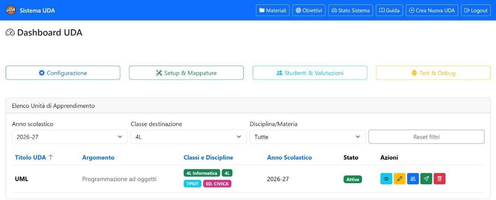

*Capitolo 01 · orientamento*

# Home e ricerca dell’UDA

La home raccoglie le unità didattiche e permette di restringere l’elenco. Per seguire questa guida, individua la riga **UML** e apri la relativa scheda.

*Home: filtri in alto e riga UML nell’elenco. Le azioni della riga aprono le sezioni della stessa UDA.*

## Filtrare e trovare UML

| Controllo | Effetto |
| --- | --- |
| Anno scolastico | Riduce l’elenco alle UDA dell’anno scelto. Per l’esempio, seleziona **2026–27**. |
| Classe | Filtra in base al gruppo associato; scegli **4L** per individuare la riga di riferimento. La scheda UML mostra anche il collegamento a 4L Informatica. |
| Materia | Mostra le UDA legate alla disciplina selezionata. |
| Reimposta filtri | Rimuove i criteri impostati e ripristina l’elenco. |
| Intestazioni tabella | Selezionando titolo, argomento, classe o anno si riordina l’elenco secondo quella colonna; lo stato è informativo e non è ordinabile. |
| Riquadri di riepilogo | Mostrano o nascondono le sezioni di navigazione corrispondenti; non filtrano l’elenco delle UDA. |

## Azioni sulla riga UML

| Azione | Cosa fa |
| --- | --- |
| Visualizza | Apre la scheda dell’UDA con metadati, gruppi associati e collegamenti alle sezioni operative. È il punto consigliato per proseguire. |
| Modifica | Apre il modulo dei dati generali. Le modifiche diventano persistenti solo con **Salva Modifiche**. |
| Assegna classi | Apre la gestione dei gruppi destinatari. Verifica prima la scheda UDA per confermare i collegamenti già presenti. |

> **Nota sul filtro classe.** L’elenco può presentare la UDA sotto il gruppo filtrato. Nella scheda collegata all’UDA risultano i due gruppi 4L e 4L Informatica; questa guida segue entrambi e non estende la consultazione ad altri gruppi.

## Altri collegamenti della home

**Materiali** e **Obiettivi** portano agli archivi corrispondenti, da cui si può selezionare l’UDA UML. **Guida** apre il file iniziale di questo manuale. **Crea Nuova UDA** avvia un nuovo modulo: non serve per consultare quella già esistente.

- [Apri la scheda UML →](../public/uda_view.php?id=UDA_20260820_6a8732bc55837)
- [Materiali e obiettivi](03-materiali-obiettivi.md)

- [← Indietro Indice della guida](index.md)
- [Prossimo → Scheda UDA e gruppi](02-uda.md)

## Mappa completa della navigazione

La barra superiore e il menu laterale separano la consultazione dell’UDA dalla configurazione dei servizi. Questa distinzione aiuta a capire dove cercare una funzione prima di modificare dati.

| Area | Pagine principali | Scopo |
| --- | --- | --- |
| UDA | Materiali, Obiettivi, Crea Nuova UDA | Costruzione e consultazione dei contenuti didattici. |
| Configurazione | Integrazioni Utente, Database, Pulizia tabelle, Autenticazione Google, Token GitHub, Template GitHub | Collegamento dei servizi e manutenzione tecnica. |
| Mappature | Gruppi didattici, Assignment GitHub | Collegamento tra classi, studenti, repository e attività. |
| Valutazioni | Gestione voti, ClasseViva, Rubrica orale, Laboratorio | Inserimento, revisione e pubblicazione delle valutazioni. |
| Diagnostica | Test integrazioni API, Test sistema, Stato sistema avanzato | Verifica dell’ambiente e dei connettori. |

## Procedura guidata per una nuova UDA

**Crea Nuova UDA** apre un wizard articolato in sette passaggi: **Info Generali**, **Classi e integrazioni**, **Materiali**, **Obiettivi**, **Domande**, **Test** e **Riepilogo**. I pulsanti di avanzamento salvano o preparano i dati del wizard secondo il passaggio corrente; prima dell’ultimo invio controlla sempre il riepilogo.

Per una UDA già esistente il percorso equivalente è più breve: apri la scheda, verifica i gruppi, completa materiali e obiettivi, prepara domande e test, poi passa a valutazioni, pubblicazione o esportazione.

## Azioni da distinguere durante la consultazione

| Tipo | Esempi | Effetto |
| --- | --- | --- |
| Lettura | Visualizza, filtri, stato sistema, anteprime | Non modifica l’archivio. |
| Salvataggio | Salva modifiche, associa gruppi, importa, salva voto | Scrive dati nel database o nella UDA. |
| Operazione esterna | Pubblica su Classroom, invia a ClasseViva, crea Forms, assignment GitHub | Scrive anche su un servizio remoto o rende visibile un contenuto. |
| Distruttiva | Elimina, rimuovi assegnazione, pulizia tabelle, reset rubrica | Può rendere difficili o impossibili i ripristini. |

Questa guida apre le pagine e ne descrive i controlli, ma durante la ricognizione non sono state eseguite operazioni di salvataggio, pubblicazione, cancellazione, pulizia o invio a servizi esterni.
