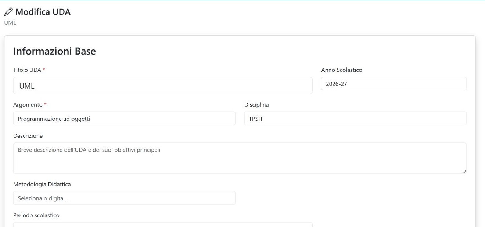

*Capitolo 02 · organizzare l’unità*

# Scheda UDA, modifica e gruppi

La scheda UML è il centro di navigazione: riepiloga titolo, argomento, disciplina, stato e gruppi, poi apre materiali, obiettivi, domande, prove e valutazioni.

*La scheda mostra entrambe le assegnazioni: 4L Informatica e 4L.*

## Collegamenti e azioni della scheda

| Controllo | Funzione |
| --- | --- |
| Dashboard | Ritorna alla home con l’elenco delle UDA. |
| Nuova UDA | Apre un modulo di creazione; non serve per consultare o aggiornare UML. |
| Modifica UDA | Apre i campi descrittivi, didattici e di stato. Per applicare le modifiche usa **Salva Modifiche**; **Annulla** torna alla scheda senza inviare il modulo. |
| Classi / Destinatari | Porta alla pagina di assegnazione. La scheda di dettaglio visualizza i due gruppi collegati all’UDA. |
| Materiali | Apre l’archivio dei materiali associati a UML. |
| Obiettivi | Apre la selezione degli obiettivi da associare o la relativa vista riepilogativa. |
| Domande | Gestisce l’archivio di domande collegato all’UDA. |
| Test | Gestisce le prove e le attività associate. |
| Rubrica orale | Apre i sei indicatori di valutazione orale, con selettore del gruppo. |
| Griglia laboratorio | Apre la valutazione per indicatori del gruppo e della materia scelti. |
| Voti | Mostra i voti registrati per l’UDA e il flusso di pubblicazione sul registro. |
| Esporta | Apre la scelta delle sezioni da includere nell’archivio. |
| Elimina UDA | Apre una pagina di conferma; confermando elimina in modo definitivo l’UDA e dati correlati, inclusi materiali, obiettivi, test, voti e assegnazioni. Non è reversibile. |

## Modificare i dati generali

*Il modulo cambia i metadati dell’UDA; le assegnazioni si gestiscono dalla pagina dedicata.*

| Campo o pulsante | Dettaglio |
| --- | --- |
| Titolo UDA | Nome visualizzato dell’unità; obbligatorio. |
| Anno scolastico | Anno a cui si riferisce l’unità. |
| Argomento | Tema principale; obbligatorio. |
| Disciplina | Disciplina associata; il campo propone valori disponibili e consente la selezione. |
| Descrizione | Testo di sintesi dell’unità. |
| Metodologia didattica | Campo con suggerimenti, modificabile nel modulo. |
| Periodo scolastico | Il menu applica le date previste dal periodo scelto. Le date sono riepilogate in campi non modificabili direttamente qui. |
| Note / prerequisiti | Annotazioni didattiche interne all’UDA. |
| Classi Target / Destinatari | Campo di sola lettura derivato dalle assegnazioni. Per cambiare i gruppi segui il collegamento alla pagina di assegnazione. |
| Stato | Seleziona lo stato dell’UDA; salva il modulo per renderlo effettivo. |
| Salva Modifiche | Invia i campi del modulo e aggiorna i dati generali. |
| Annulla / Torna alla Visualizzazione | Rientra nella scheda senza salvare i cambiamenti non inviati. |

> **Due viste diverse dei gruppi.** Nel dettaglio dell’UDA sono associati **4L** e **4L Informatica**. Nel modulo di modifica il campo riepilogativo “Classi Target / Destinatari” mostra **4L Informatica** ed è in sola lettura. Per consultare o gestire le assegnazioni usa la pagina dedicata, senza dedurre il contenuto del campo riepilogativo dalla lista del dettaglio.

## Gestione delle assegnazioni

La pagina raggiunta da **Classi / Destinatari** mostra le assegnazioni esistenti e una lista di gruppi selezionabili. Nella ricognizione sono stati considerati solo i due gruppi collegati all’UDA.

| Controllo | Funzione |
| --- | --- |
| Gruppi già assegnati | Mostra le assegnazioni presenti. Le caselle corrispondenti alla selezione corrente risultano già spuntate e disabilitate nell’elenco di aggiunta. |
| Rimuovi assegnazione | Chiede conferma e poi scollega quel gruppo dall’UDA. La rimozione cambia i destinatari dell’unità. |
| Caselle dei gruppi disponibili | Selezionano uno o più gruppi da associare. La pagina può mostrare altri gruppi: per il percorso di questa guida considera solo 4L e 4L Informatica. |
| Assegna Gruppi Selezionati | Salva le nuove assegnazioni selezionate e torna alla scheda dell’UDA con l’esito dell’operazione. |
| Visualizza UDA | Ritorna al dettaglio UML. |

> **Attenzione:** aggiungere o rimuovere un gruppo modifica i destinatari della UDA. In questa guida si consultano le assegnazioni esistenti senza cambiare la selezione.

- [Torna alla scheda UML →](../public/uda_view.php?id=UDA_20260820_6a8732bc55837)
- [Apri assegnazioni ↗](../public/uda_assign.php?id=UDA_20260820_6a8732bc55837)
- [Prosegui a materiali e obiettivi](03-materiali-obiettivi.md)

- [← Precedente Home e ricerca](01-home.md)
- [Prossimo → Materiali e obiettivi](03-materiali-obiettivi.md)
