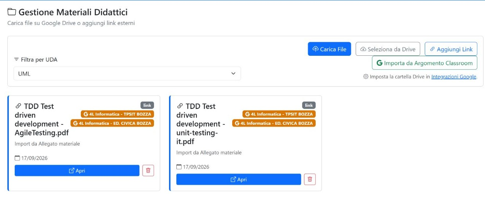
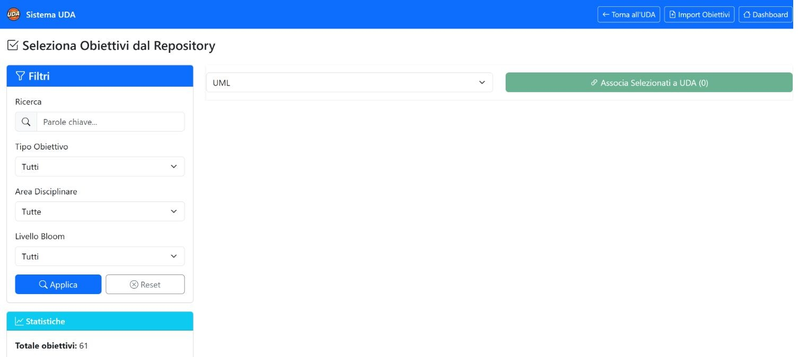

*Capitolo 03 · risorse e traguardi*

# Materiali e obiettivi

I materiali raccolgono le risorse didattiche dell’UDA; gli obiettivi collegano il lavoro ai traguardi del repertorio. Nello stato osservato UML aveva due materiali e nessun obiettivo associato.

*Archivio materiali: il filtro consente di mantenere il contesto dell’UDA e mostra le risorse collegate.*

## Gestire i materiali

| Controllo | Effetto |
| --- | --- |
| Filtro UDA | Seleziona UML per vedere solo le risorse associate a questa unità. |
| Carica file | Apre la selezione di un file locale e i campi di caricamento; il file entra nell’archivio solo dopo l’invio. |
| Seleziona da Drive | Apre il selettore di file remoto disponibile e associa il documento scelto all’UDA. |
| Aggiungi link | Consente di registrare un collegamento web con titolo e URL. |
| Importa da argomento | Propone materiali già associati allo stesso argomento, così da poterli collegare anche all’UDA corrente. |
| Apri una scheda materiale | Apre il file o l’indirizzo registrato per la risorsa. |
| Elimina | Rimuove il materiale dall’UDA dopo l’azione di conferma, quando richiesta. |

**Esempio di consultazione:** seleziona UML nel filtro, apri una delle due schede PDF e usa il ritorno alla pagina materiali per passare all’altra risorsa. L’esempio non richiede di caricare o rimuovere file.

*Selettore degli obiettivi: prima si restringe il repertorio, poi si associa alla UDA la selezione desiderata.*

## Cercare e associare obiettivi

| Controllo | Effetto |
| --- | --- |
| Cerca | Filtra il repertorio in base al testo digitato. |
| Tipologia | Limita i risultati alla categoria selezionata. |
| Area | Filtra gli obiettivi per area tematica. |
| Livello Bloom | Seleziona il livello cognitivo usato per classificare il traguardo. |
| Applica filtri | Aggiorna il repertorio secondo i criteri impostati. |
| Reset | Rimuove i filtri e ripristina i risultati iniziali. |
| UDA | Sceglie l’unità destinataria; mantieni UML per questo percorso. |
| Selezione obiettivo | Spunta una o più voci del repertorio; la selezione resta in attesa finché non si conferma l’associazione. |
| Associa Selezionati a UDA (n) | Collega all’UDA gli obiettivi selezionati. Il numero indica quanti sono in coda; il pulsante resta inattivo con selezione vuota. |
| Importa obiettivi | Apre l’importazione strutturata; il flusso prevede il modello, il caricamento e la validazione prima del salvataggio. |

> **Stato osservato.** Il repertorio mostrava 61 obiettivi disponibili e 0 associati a UML. La guida spiega il flusso senza selezionare né associare nuove voci.

- [Apri materiali UML →](../public/materiali.php?id=UDA_20260820_6a8732bc55837)
- [Apri obiettivi UML ↗](../public/obiettivi_seleziona.php?id_uda=UDA_20260820_6a8732bc55837)
- [Domande](04-domande.md)

- [← Precedente Scheda UDA e gruppi](02-uda.md)
- [Prossimo → Domande](04-domande.md)
