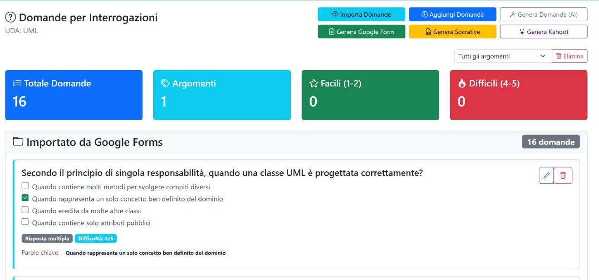

*Capitolo 04 · banca delle domande*

# Consultare e preparare le domande

La pagina raccoglie le domande dell’UDA e offre strumenti per crearne di nuove, importarle e riutilizzarle nelle prove. Nell’archivio UML osservato erano presenti 16 domande.

*Elenco delle domande: ogni card riassume contenuto e metadati della voce.*

## Comandi principali

| Controllo | Funzione |
| --- | --- |
| Aggiungi Domanda | Apre il modulo per inserire i campi della nuova domanda. **Salva Domanda** aggiunge la voce all’UDA; **Annulla** chiude il modulo senza inviarlo. |
| Modifica | Apre il modulo della domanda selezionata; il salvataggio aggiorna quella voce. |
| Modifica / Elimina nella scheda | Le azioni della scheda aggiornano o rimuovono la domanda scelta, con conferma per l’eliminazione. |
| Importa domande | Apre un flusso guidato: si sceglie una sorgente o un formato strutturato, si carica e controlla un’anteprima, quindi si conferma l’importazione. |
| Genera Domande (AI) | Apre la generazione assistita di nuove domande; controlla il testo e la risposta proposta prima di salvarle nell’archivio. |
| Genera Google Form | Apre la preparazione di un modulo a partire dalle domande disponibili. |
| Genera Socrative | Apre la preparazione di un quiz Socrative con le domande disponibili. |
| Genera Kahoot | Apre la preparazione di un quiz Kahoot con le domande disponibili. |
| Argomento nel modulo Elimina | Sceglie l’ambito dell’operazione massiva; non filtra le schede mostrate nella pagina. |
| Elimina | Chiede conferma e cancella dall’UDA tutte le domande se è selezionato “Tutti gli argomenti”, oppure quelle del solo argomento scelto. |

## Importazione strutturata: sequenza d’uso

1. Scegli il formato strutturato disponibile (JSON, CSV o Excel).
2. Scarica il relativo modello e prepara le colonne richieste: argomento, tipo, domanda, risposta attesa, parole chiave, difficoltà, tempo, ordine e note.
3. Carica il file oppure inserisci il contenuto nel campo previsto; il caricamento da anteprima consente di correggere prima di inviare.
4. Usa **Mostra anteprima** per verificare le voci riconosciute e correggere eventuali errori.
5. Conferma l’importazione solo dopo il controllo: è il passaggio che aggiunge le domande all’UDA.

> **Prima di salvare:** controlla che il testo della domanda, la risposta attesa e l’ordine siano corretti. Creazione, importazione, modifica ed eliminazione hanno effetto sull’archivio.

- [Apri l’archivio UML →](../public/uda_questions.php?id=UDA_20260820_6a8732bc55837)
- [Apri generazione domande ↗](../public/uda_questions_auto.php?id_uda=UDA_20260820_6a8732bc55837)
- [Apri generatore Google Form ↗](../public/generate_google_form.php?id=UDA_20260820_6a8732bc55837)
- [Apri generatore Socrative ↗](../public/generate_socrative_quiz.php?id=UDA_20260820_6a8732bc55837)
- [Apri generatore Kahoot ↗](../public/generate_kahoot_quiz.php?id=UDA_20260820_6a8732bc55837)
- [Passa a test e attività](05-test.md)

- [← Precedente Materiali e obiettivi](03-materiali-obiettivi.md)
- [Prossimo → Test e attività](05-test.md)

## Modulo di una domanda

**Aggiungi Domanda** e **Modifica** usano gli stessi concetti. I campi osservati sono:

| Campo | Uso |
| --- | --- |
| Argomento | Raggruppa la domanda e permette le operazioni per argomento. |
| Difficoltà | Valore da 1 a 5. |
| Tipo | Risposta aperta oppure scelta multipla. |
| Testo domanda | Traccia mostrata allo studente. |
| Risposta attesa | Criterio o soluzione usato per la correzione. |
| Parole chiave | Termini utili alla ricerca o alla generazione. |

Salva solo dopo avere controllato che il tipo della domanda sia coerente con la risposta attesa. L’eliminazione singola e quella per argomento richiedono particolare attenzione perché modificano l’archivio dell’UDA.

## Generazione assistita dall’AI

La schermata AI raccoglie il contesto selezionato — argomento, disciplina, classi, eventuali obiettivi e allegati — e consente di scegliere provider, modello, conteggio di domande aperte/chiuse e difficoltà. Il prompt e il risultato grezzo restano modificabili prima dell’importazione.

La casella relativa ai link pubblici temporanei consente di scaricare allegati tramite URL temporanei: attivala solo se il provider e il trattamento dei materiali lo permettono. Non includere nel prompt dati personali, credenziali, email, roster o documenti non destinati al provider esterno. **Genera bozza** prepara un risultato; **Importa anteprima** lo rende parte dell’UDA.

## Generatori esterni

I generatori Google Forms, Socrative e Kahoot consentono di filtrare le domande per tipo e selezionare tutte o solo alcune voci. Google Forms prepara un test con titolo, tipo, descrizione, durata e punteggio; Socrative e Kahoot preparano file compatibili con i rispettivi flussi di importazione. La generazione o l’esportazione può creare un artefatto esterno o un file locale: verifica sempre le domande selezionate prima dell’ultimo pulsante.
