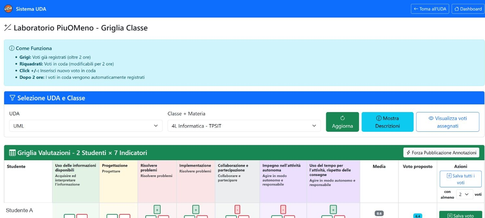
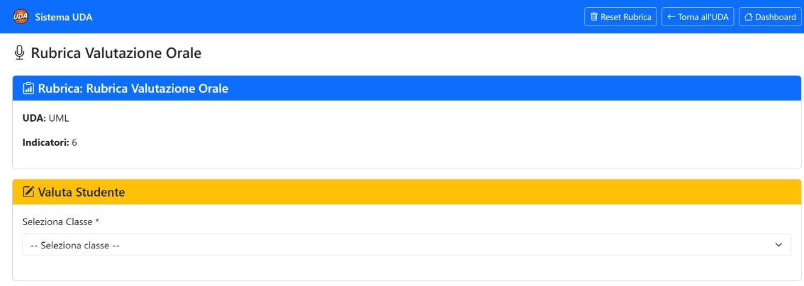
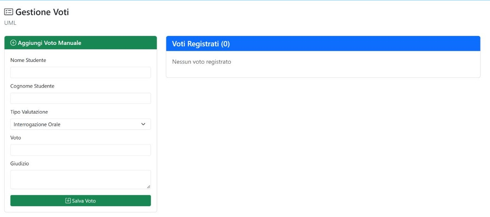

*Capitolo 06 · valutare e pubblicare*

# Valutazioni e registro

L’UDA offre rubriche per le osservazioni orali e di laboratorio e una pagina per i voti. Quando un voto è pronto, la pagina voti permette di selezionare quelli non ancora inviati e pubblicarli sul registro.

## Griglia di laboratorio

*La schermata documenta la griglia collegata alla UDA, con il gruppo 4L Informatica e indicatori di valutazione.*

| Controllo | Funzione |
| --- | --- |
| UDA / classe / materia | Sceglie l’unità, il gruppo e la materia del contesto di valutazione. Verifica il gruppo prima di inserire osservazioni. |
| Aggiorna | Ricarica la griglia con la selezione corrente. |
| Mostra descrizioni | Espande o nasconde le descrizioni degli indicatori. |
| Visualizza voti assegnati | Mostra la vista dei voti già attribuiti nel contesto selezionato. |
| Forza pubblicazione annotazioni | Mostra una richiesta di conferma e, se confermata, pubblica le annotazioni in coda. La richiesta è il punto di controllo: non viene mostrata un’anteprima separata. |
| + / − nella cella | Aggiunge o riduce il livello di valutazione e mette la modifica in coda. |
| Salva voto | Registra il voto della riga quando sono rispettate le condizioni mostrate nella griglia. |
| Salva tutti i voti | Registra in blocco i voti in coda quando sono raggiunte le soglie minime indicate. |

> **Finestra di correzione.** La pagina distingue le valutazioni in coda da quelle già registrate: quelle in coda restano modificabili per due ore; dopo la registrazione la griglia le mostra come consolidate. Nella schermata consultata risultavano cinque valutazioni in coda, zero registrate e cinque complessive. Prima di usare i comandi di salvataggio, ricontrolla gruppo, studente e indicatori.

## Rubrica orale

*La rubrica raccoglie sei indicatori e consente di scegliere il gruppo da valutare.*

Seleziona il gruppo nel menu e consulta gli indicatori prima di assegnare una valutazione. Nell’UDA osservata il selettore era vuoto, quindi la schermata non mostra una classe preselezionata.

| Controllo | Funzione |
| --- | --- |
| Reset Rubrica | Chiede conferma e poi cancella la rubrica e le valutazioni associate all’UDA. È un’azione distruttiva: non usarla durante la sola consultazione. |

## Voti e pubblicazione sul registro

*La pagina voti dell’UDA consultata era vuota: 0 voti registrati.*

| Campo o pulsante | Funzione |
| --- | --- |
| Nome e cognome | Identifica lo studente a cui si riferisce il voto. |
| Tipo | Indica la tipologia della valutazione, ad esempio orale, scritta, pratica o test. |
| Voto | Inserisce il valore numerico da registrare. |
| Giudizio | Permette di aggiungere una nota descrittiva. |
| Salva voto | Registra il voto nell’elenco dell’UDA. |
| Pubblica sul registro | Apre la selezione dei voti non ancora pubblicati; spunta i record da inviare e conferma con **Pubblica Selezionati**. |
| Modifica / elimina voto | Consente di correggere o rimuovere il singolo record prima della pubblicazione, secondo le azioni presenti nella riga. |
| Elimina Selezionati | Rimuove i voti selezionati dopo la conferma proposta. Controlla con attenzione quali righe sono spuntate. |

1. Registra il voto nella pagina dell’UDA e verifica studente, tipologia, valore e giudizio.
2. Controlla che il voto sia associato al gruppo corretto tra 4L e 4L Informatica.
3. Apri **Pubblica sul registro** e seleziona solo i voti che vuoi trasmettere.
4. Rivedi il riepilogo e usa **Pubblica Selezionati** per completare l’operazione.

> **Stato osservato.** UML non conteneva voti registrati. Non è stato inserito né pubblicato alcun voto. La pubblicazione sul registro si attiva quando esistono voti selezionabili.

- [Apri i voti UML →](../public/uda_grades.php?id=UDA_20260820_6a8732bc55837)
- [Apri rubrica orale ↗](../public/rubrica_orale_v2.php?id_uda=UDA_20260820_6a8732bc55837)
- [Apri griglia laboratorio ↗](../public/laboratorio_griglia.php?id_uda=UDA_20260820_6a8732bc55837&id_classe_cv=2153414&id_materia_cv=213121)

- [← Precedente Test e attività](05-test.md)
- [Prossimo → Esportazione](07-esportazione.md)

## Rubrica orale

La pagina della rubrica orale mostra sei indicatori e il comando **Reset Rubrica**. Il reset è distruttivo: cancella la configurazione della rubrica e le valutazioni collegate all’UDA, quindi non va usato per una semplice verifica.

Prima di valutare, seleziona la classe e controlla che l’UDA e la materia siano corrette. La rubrica deve essere configurata prima di registrare i giudizi, perché gli indicatori definiscono il contesto della valutazione.

## Griglia di laboratorio

La griglia collega UDA, classe e materia e mostra gli indicatori per ogni studente. Nella pagina osservata il comportamento è esplicitato così:

- una cella grigia rappresenta un voto già registrato oltre la soglia prevista;
- una cella evidenziata rappresenta una valutazione in coda, ancora modificabile;
- i pulsanti **+** e **−** aggiungono o riducono la valutazione in coda;
- dopo due ore la valutazione in coda passa automaticamente a registrata;
- **Salva tutti i voti** invia le modifiche, mentre **Forza pubblicazione annotazioni** può renderle visibili sul registro.

La pagina include anche l’opzione per mostrare le descrizioni degli indicatori e un riepilogo di valutazioni in coda/registrate. Controlla il riepilogo prima del salvataggio: l’azione riguarda più studenti e più indicatori contemporaneamente.

## Tre livelli di gestione dei voti

| Pagina | Funzione |
| --- | --- |
| Voti dell’UDA | Inserimento manuale di voto, tipo e giudizio associati all’unità. |
| Gestione voti ClasseViva | Selezione di classe e materia per lavorare con il registro esterno. |
| Verifica voti | Controllo degli elementi sincronizzati, in attesa o con errore. |

Se il voto deve restare interno, lavora nella pagina dell’UDA. Se deve raggiungere ClasseViva, usa il flusso di pubblicazione e poi verifica lo stato: non considerare sufficiente il solo salvataggio locale.
