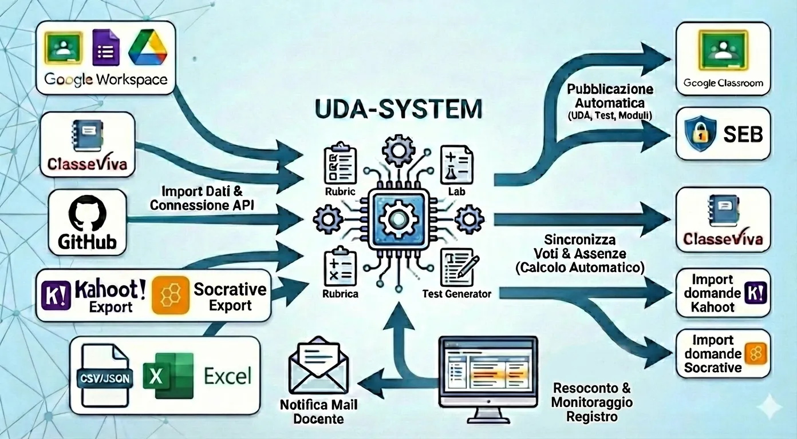
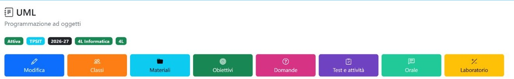
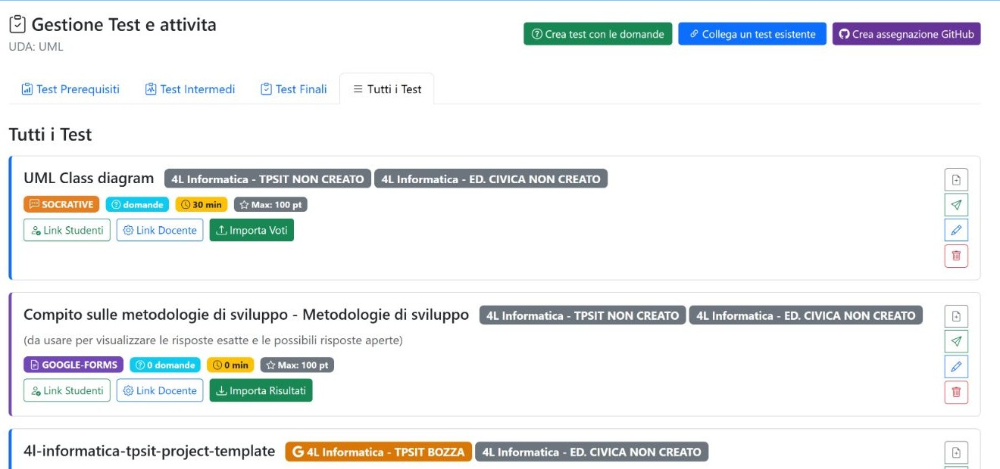
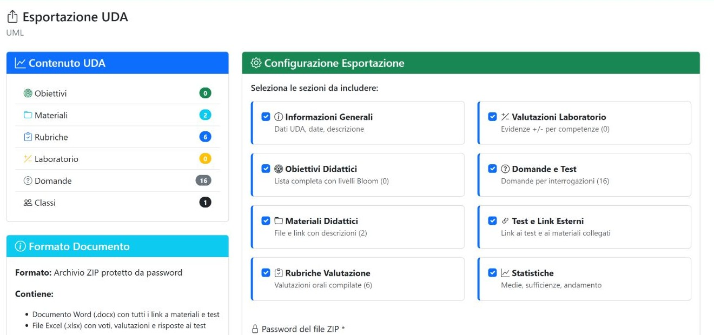

# Guida utente del portale didattico

Questa guida accompagna nella consultazione dell’UDA **UML**, collegata ai gruppi **4L** e **4L Informatica**, e nelle relative funzioni per materiali, obiettivi, domande, prove, valutazioni e pubblicazione sul registro.

## Come leggere la guida

Questa pagina è l’edizione **Markdown compatibile con GitHub**: GitHub visualizza Markdown e immagini, ma non esegue HTML e CSS nella vista dei file del repository. I file HTML e il foglio di stile restano comunque nella cartella per conservare la versione navigabile completa.

## Apri la guida

[Vai all’indice Markdown completo](index.md)

Per il rendering grafico completo è disponibile anche la [versione HTML](index.html), da aprire quando la cartella è servita da un web server o da GitHub Pages.

## Percorso consigliato

1. [Home e ricerca dell’UDA](01-home.md)
2. [Scheda UDA, modifica e gruppi](02-uda.md)
3. [Materiali e obiettivi](03-materiali-obiettivi.md)
4. [Domande](04-domande.md)
5. [Test e attività](05-test.md)
6. [Valutazioni e registro](06-valutazioni.md)
7. [Esportazione](07-esportazione.md)

Le schermate e gli esempi riportano solo il percorso dell’UDA indicata. I conteggi descrivono lo stato osservato al momento della ricognizione e possono cambiare.

## Anteprima dei capitoli

### 1. Home e ricerca

Filtri e tabella permettono di individuare l’UDA. Le azioni sulla riga aprono la scheda, i materiali, le domande, i test e le valutazioni collegate.

[Apri il capitolo Markdown](01-home.md) · [versione HTML](01-home.html)

### 2. Scheda UDA e gruppi

La scheda raccoglie dati generali, collegamenti e assegnazioni ai gruppi. La guida distingue la modifica dei metadati dalla gestione dei destinatari.

[Apri il capitolo Markdown](02-uda.md) · [versione HTML](02-uda.html)

### 3. Materiali e obiettivi

Il capitolo mostra come filtrare i materiali sull’UDA e come cercare e associare gli obiettivi senza perdere il contesto di lavoro.

[Apri il capitolo Markdown](03-materiali-obiettivi.md) · [versione HTML](03-materiali-obiettivi.html)

### 4. Domande

Sono descritti archivio, inserimento, modifica, importazione strutturata e generazione assistita delle domande.

[Apri il capitolo Markdown](04-domande.md) · [versione HTML](04-domande.html)

### 5. Test e attività

Il capitolo illustra la gestione delle prove e il collegamento di attività già esistenti all’UDA.

[Apri il capitolo Markdown](05-test.md) · [versione HTML](05-test.html)

### 6. Valutazioni e registro

La guida riunisce griglia di laboratorio, rubrica orale, inserimento dei voti e pubblicazione selettiva sul registro.

[Apri il capitolo Markdown](06-valutazioni.md) · [versione HTML](06-valutazioni.html)

### 7. Esportazione

L’ultimo capitolo descrive la scelta delle sezioni e la generazione del pacchetto esportabile dell’UDA.

[Apri il capitolo Markdown](07-esportazione.md) · [versione HTML](07-esportazione.html)
